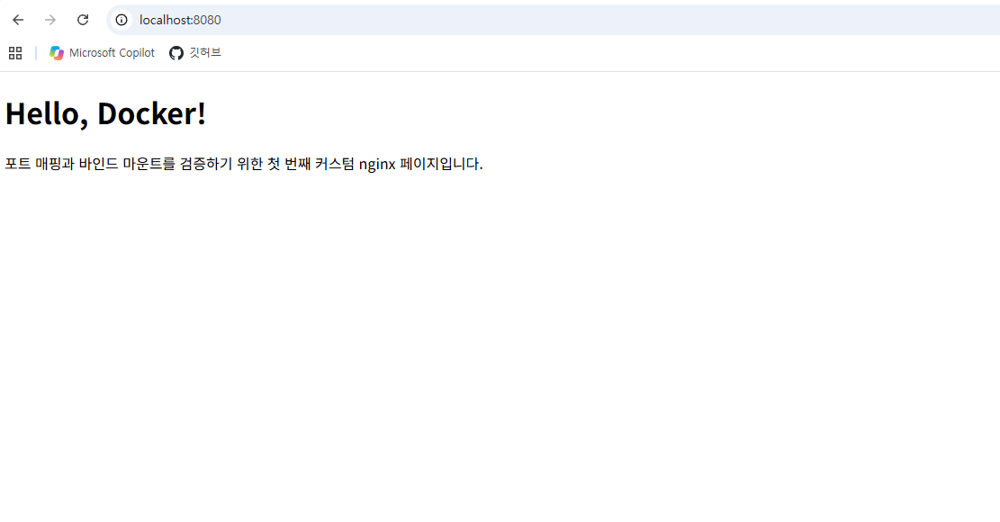
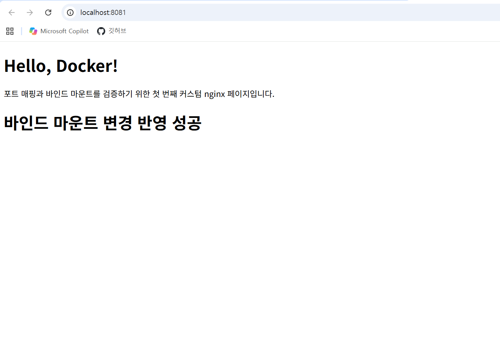
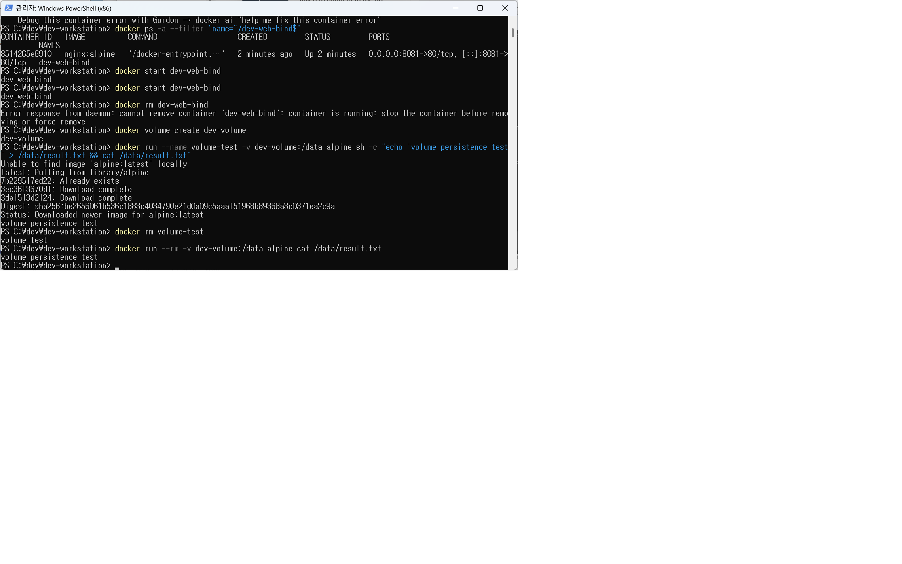
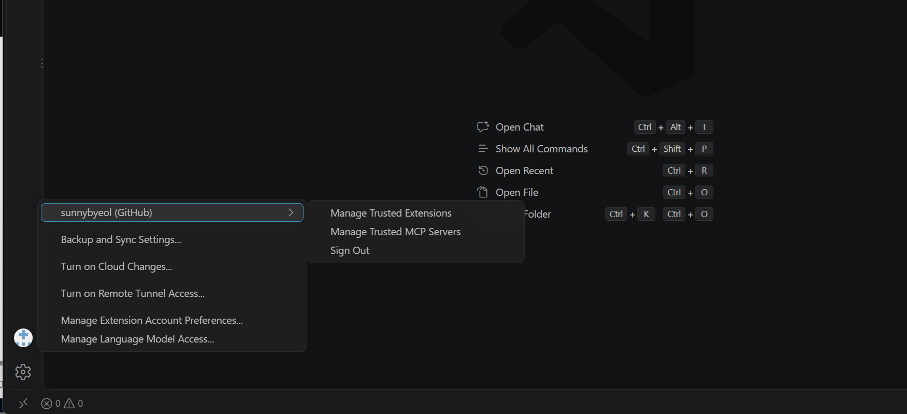

# ia-codyssey
Github과 Codyssey를 연동하기 위해 만들어진 Repository입니다.

프로젝트 개요
# sunnybyeol Workstation 구축 결과

## 1. 프로젝트 개요

이 저장소는 개발 워크스테이션 구축 과제 제출용 저장소이다.

주요 목표는 다음과 같다.

- 터미널 환경 확인
- Docker 설치 및 운영 명령 검증
- Dockerfile 기반 웹 서버 컨테이너 실행
- 포트 매핑을 통한 웹 접속 확인
- 바인드 마운트 변경 반영 확인
- Docker 볼륨 영속성 확인
- Git 설정 및 GitHub / VSCode 연동 확인

---

## 2. 실행 환경

| 항목 | 내용 |
|---|---|
| OS | Windows 11 |
| Shell | PowerShell / zsh / bash |
| Terminal | Windows Terminal / VSCode Terminal |
| Docker Version | Docker version 29.9.2, build a82e528 |
| Git Version | git version 2.56.0.windows.4 |

### Docker 버전 확인

```bash
docker --version
```

결과:

```text
Docker version 29.9.2, build a82e528
```

로그 파일:

- [logs/docker-version.txt](logs/docker-version.txt)

### Docker info 확인

```bash
docker info
```

결과 위치:

- [logs/docker-info.txt](logs/docker-info.txt)

---

## 3. 수행 항목 체크리스트

| 항목 | 완료 여부 | 증거 |
|---|---:|---|
| 터미널 명령 실행 | ✅ | README 명령 로그 |
| 권한 확인 | ✅ | Docker 명령 정상 실행 |
| Docker 설치 확인 | ✅ | [docker-version.txt](logs/docker-version.txt) |
| Docker 정보 확인 | ✅ | [docker-info.txt](logs/docker-info.txt) |
| Dockerfile 작성 | ✅ | [Dockerfile](Dockerfile) |
| 웹 서버 소스코드 작성 | ✅ | [app/index.html](app/index.html) |
| 이미지 빌드 | ✅ | [docker-images.txt](logs/docker-images.txt) |
| 컨테이너 실행 | ✅ | [docker-ps-a.txt](logs/docker-ps-a.txt) |
| 포트 매핑 접속 | ✅ | [port-access.png](screenshots/port-access.png) |
| 바인드 마운트 검증 | ✅ | [bind-before.png](screenshots/bind-before.png), [bind-after.png](screenshots/bind-after.png) |
| Docker 볼륨 검증 | ✅ | [volume-proof.png](screenshots/volume-proof.png) |
| Git 설정 | ✅ | git config 결과 |
| GitHub 저장소 업로드 | ✅ | GitHub Repository |
| VSCode GitHub 연동 | ✅ | [vscode-github-login.png](screenshots/vscode-github-login.png) |

---

## 4. Dockerfile 기반 웹 서버

### Dockerfile

```dockerfile
FROM nginx:alpine

COPY app/ /usr/share/nginx/html/

EXPOSE 80
```

### 웹 서버 소스코드

- [app/index.html](app/index.html)

---

## 5. Docker 빌드 및 실행 로그

### 이미지 빌드

```bash
docker build -t dev-workstation-web:1.0 .
```

결과:

```text
[+] Building 6.2s (8/8) FINISHED                                             docker:desktop-linux
 => [internal] load build definition from Dockerfile                                         0.0s
 => => transferring dockerfile: 716B                                                         0.0s
 => [internal] load metadata for docker.io/library/nginx:alpine                              2.0s
 => [auth] library/nginx:pull token for registry-1.docker.io                                 0.0s
 => [internal] load .dockerignore                                                            0.0s
 => => transferring context: 2B                                                              0.0s
 => [internal] load build context                                                            0.0s
 => => transferring context: 354B                                                            0.0s
 => [1/2] FROM docker.io/library/nginx:alpine@sha256:785835ea65db4bba6f021acc0f3be91b0fef76  3.0s
 => => resolve docker.io/library/nginx:alpine@sha256:785835ea65db4bba6f021acc0f3be91b0fef76  0.0s
 => => sha256:b9b388a21ecfde6ac80505f23f527146a2129dfb104e79b029bbd00d4cc 20.53MB / 20.53MB  2.5s
 => => sha256:9b0f7dfe35b2711a17f60dadd6d4035dc0cdee152538cc5c0987029e94679 1.40kB / 1.40kB  0.4s
 => => sha256:2ec5fb117ffa9a78b15fb6a78745ffc569c8da0aee9f36ace4cd67a44b1fe 1.21kB / 1.21kB  0.6s
 => => sha256:26185d08a3ec318dd85a6c9f2172e714ec13cececd7f33c533b40b1689f9fedb 404B / 404B   0.6s
 => => sha256:7cc330898115ce55acccb0cc1e7dd091df4410c8c5f3c540710ee0ac689f5fcb 964B / 964B   0.2s
 => => sha256:657023555a2a19dc6036468198bb350d2c7feaac7f2d0a3901b4dd3cb25e40c5 629B / 629B   0.2s
 => => sha256:12b85cff06fd7d383d36a9c96503fe049c9d4bf3dfda5cbb9ffa6ae99b9c0 1.94MB / 1.94MB  0.8s
 => => sha256:7b229517ed222597277036d94892173207d01a731ab3a88eeb1de2e963a2c 3.85MB / 3.85MB  1.3s
 => => extracting sha256:7b229517ed222597277036d94892173207d01a731ab3a88eeb1de2e963a2c788    0.2s
 => => extracting sha256:12b85cff06fd7d383d36a9c96503fe049c9d4bf3dfda5cbb9ffa6ae99b9c07a6    0.2s
 => => extracting sha256:657023555a2a19dc6036468198bb350d2c7feaac7f2d0a3901b4dd3cb25e40c5    0.0s
 => => extracting sha256:7cc330898115ce55acccb0cc1e7dd091df4410c8c5f3c540710ee0ac689f5fcb    0.0s
 => => extracting sha256:26185d08a3ec318dd85a6c9f2172e714ec13cececd7f33c533b40b1689f9fedb    0.0s
 => => extracting sha256:2ec5fb117ffa9a78b15fb6a78745ffc569c8da0aee9f36ace4cd67a44b1fef79    0.0s
 => => extracting sha256:9b0f7dfe35b2711a17f60dadd6d4035dc0cdee152538cc5c0987029e94679548    0.0s
 => => extracting sha256:b9b388a21ecfde6ac80505f23f527146a2129dfb104e79b029bbd00d4cc1a919    0.4s
 => [2/2] COPY site/ /usr/share/nginx/html/                                                  0.1s
 => exporting to image                                                                       0.9s
 => => exporting layers                                                                      0.1s
 => => exporting manifest sha256:23bb47b0b9903edb2c245537ec19d0de4bd634321c5616a0425ba122c8  0.0s
 => => exporting config sha256:b142d052a60e923a7ba4278677f46b3a2d3ee3a07c4b25fccbcd729274d8  0.0s
 => => exporting attestation manifest sha256:41fa0e8307391611e5181daead79986f86f3c4f1774caf  0.0s
 => => exporting manifest list sha256:ebde0a34a20f6d75fa84f43ec5a794ff24e2d236ca95734ee6d29  0.0s
 => => naming to docker.io/library/dev-workstation-web:1.0                                   0.0s
 => => unpacking to docker.io/library/dev-workstation-web:1.0                                0.8s
```

### 이미지 확인

```bash
docker images
```

결과 위치:

- [logs/docker-images.txt](logs/docker-images.txt)

### 컨테이너 실행

```bash
docker run -d --name dev-web -p 8080:80 dev-workstation-web:1.0
```

### 컨테이너 확인

```bash
docker ps -a
```

결과 위치:

- [logs/docker-ps-a.txt](logs/docker-ps-a.txt)

---

## 6. 포트 매핑 접속 증거

컨테이너 실행 시 다음 옵션을 사용했다.

```bash
-p 8080:80
```

브라우저 접속 주소:

```text
http://localhost:8080
```

접속 성공 화면:



---

## 7. Docker 운영 명령 실행 기록

### docker logs

```bash
docker logs dev-web
```

결과 위치:

- [logs/docker-logs.txt](logs/docker-logs.txt)

### docker stats

```bash
docker stats --no-stream
```

결과 위치:

- [logs/docker-stats.txt](logs/docker-stats.txt)

---

## 8. 바인드 마운트 검증

### 실행 명령

```bash
docker rm -f dev-web
docker run -d --name dev-web-bind -p 8081:80 -v "$PWD/app:/usr/share/nginx/html:ro" nginx:alpine
```

### 변경 전



### 호스트 파일 수정

수정 파일:

- [app/index.html](app/index.html)

수정 내용 예시:

```html
<h1>바인드 마운트 변경 반영 성공</h1>
```

### 변경 후


### 검증 결과

이미지를 다시 빌드하지 않고도 호스트의 `app/index.html` 변경사항이 컨테이너에서 제공하는 웹 페이지에 반영되는 것을 확인했다.

---

## 9. Docker 볼륨 영속성 검증

### 볼륨 생성

```bash
docker volume create dev-volume
```

### 볼륨에 데이터 작성

```bash
docker run --name volume-test -v dev-volume:/data alpine sh -c "echo 'volume persistence test' > /data/result.txt && cat /data/result.txt"
```

### 컨테이너 삭제

```bash
docker rm volume-test
```

### 새 컨테이너에서 데이터 확인

```bash
docker run --rm -v dev-volume:/data alpine cat /data/result.txt
```

결과:

```text
volume persistence test
```

증거:



---

## 10. Git 설정 및 GitHub / VSCode 연동

### Git 버전 확인

```bash
git --version
```

결과:

```text
git version 2.56.0.windows.4
```

### Git 사용자 정보 설정

```bash
git config --global user.name "GitHub sunnybyeol"
git config --global user.email "GitHub noreply witch_jh@naver.com"
git config --global init.defaultBranch main
```

### Git 설정 확인

```bash
git config --global --list
```

결과:

```text
user.name=GitHub sunnybyeol
user.email=witch_jh@naver.com
init.defaultbranch=main
```

### VSCode GitHub 연동

VSCode에서 GitHub 계정 로그인을 완료하고 저장소와 연동했다.

증거:



주의:

- 비밀번호, 토큰, 인증 코드 등 민감정보는 캡처하지 않았다.

---

## 11. 트러블슈팅

### 문제 1. Docker 명령 실행 시 권한 오류 발생

문제:

```text
permission denied while trying to connect to the Docker daemon socket
```

원인 가설:

- 현재 사용자가 Docker 데몬에 접근할 권한이 없을 수 있다.
- Docker Desktop 또는 Docker 데몬이 실행 중이 아닐 수 있다.

확인:

```bash
docker info
```

해결:

- Docker Desktop을 실행했다.
- Linux 환경에서는 필요한 경우 사용자를 docker 그룹에 추가한다.

```bash
sudo usermod -aG docker $USER
```

이후 터미널을 재시작하고 다시 확인했다.

```bash
docker info
```

---

### 문제 2. 포트가 이미 사용 중이어서 컨테이너 실행 실패

문제:

```text
Bind for 0.0.0.0:8080 failed: port is already allocated
```

원인 가설:

- 기존 컨테이너 또는 다른 프로세스가 8080 포트를 사용 중일 수 있다.

확인:

```bash
docker ps -a
```

해결:

기존 컨테이너를 삭제하거나 다른 포트를 사용했다.

```bash
docker rm -f dev-web
docker run -d --name dev-web -p 8081:80 dev-workstation-web:1.0
```

대안:

```text
http://localhost:8081
```

로 접속한다.

---

## 12. 제출 저장소

GitHub Repository:

```text
https://github.com/사용자명/dev-workstation
```
